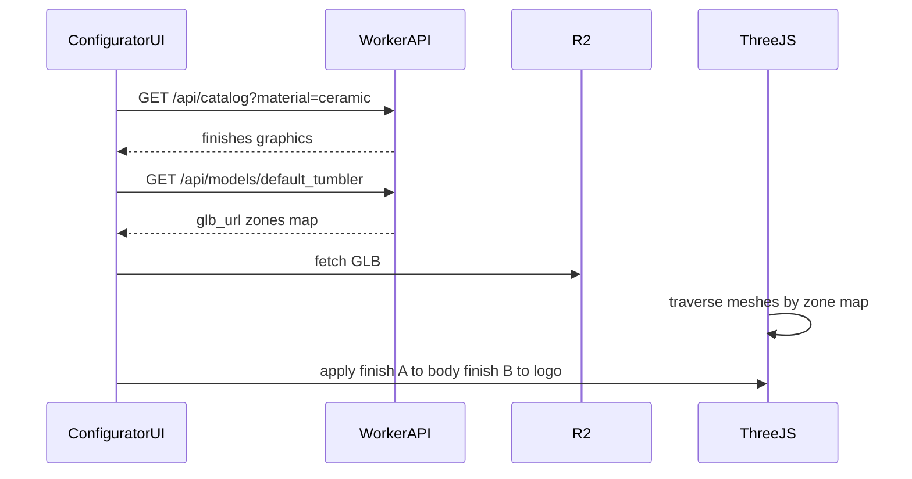

# Chapter 13 — 3D preview and model upload

[← 12 — Database and multi-material](12-database-multi-material.md) · [Project book](README.md) · [10 — Roadmap →](10-roadmap-and-status.md)

**Plain language summary:** The configurator shows each material's hero product (tumbler, mug, glass cold cup, plastic cold cup) in real-time 3D, in the selected finish. Colours are sampled from the real factory photos, patterned finishes use the photo itself as a texture, and the body and logo can carry different finishes. This chapter also describes the later path to factory-accurate GLB models and user-uploaded meshes.

---

## Stage 1 — Cube (retired)

The first preview was a single cube with one `MeshStandardMaterial`, coloured from the finish name. It was replaced by Stage 1b.

---

## Stage 1b — Code-built products with photo-based finishes (current)

**For: Everyone**

| Piece | Location | What it does |
|-------|----------|--------------|
| Product models | [`public/js/product-models-3d.js`](../public/js/product-models-3d.js) | One hero product per material, built from measured side profiles ([`product-profiles.js`](../public/js/product-profiles.js)) spun around the centre axis (`LatheGeometry`). Meshes named `body`, `handle`, `logo`, `lid`, `straw`, `liner`. `surfaceUV()` is the one rule for where a texture lands (body and handle), shared with the 2D passes. |
| Finish colour map | [`public/js/finish-albedo.js`](../public/js/finish-albedo.js) | One canvas per finish covering the whole surface: de-lit photo texture, gradient, speckle or flat colour + grain. Used by both 3D and 2D. |
| 2D compositor | [`public/js/finish-composite-2d.js`](../public/js/finish-composite-2d.js) | Lights the colour map with the exported shell passes (see 2D view below). |
| Finish rules | [`public/js/finish-render-spec.js`](../public/js/finish-render-spec.js) | Pure function: finish name + process + sampled colours → physical material description (roughness, metalness, clearcoat, iridescence, transmission, gradient, glitter flakes, speckle, bump, photo texture). Unit-tested in [`test/finish-render-spec.test.mjs`](../test/finish-render-spec.test.mjs). |
| Materials and textures | [`public/js/finish-material-3d.js`](../public/js/finish-material-3d.js) | Builds `MeshPhysicalMaterial`, gradient / speckle maps, factory-photo pattern maps, and procedural flake and bump maps. |
| Studio stage | [`public/js/product-stage-3d.js`](../public/js/product-stage-3d.js) | Renderer, studio reflections (`RoomEnvironment`), soft shadow, camera framing per product, per-zone finishes. Supports `alpha` / `showEnvironment` for shell export. |
| Shared colour data | [`public/js/finish-render-data.js`](../public/js/finish-render-data.js) | Loads sampled colours + overrides with no Three.js dependency (shared by 2D and 3D). |
| Preview facade | [`public/js/configurator-preview.js`](../public/js/configurator-preview.js) | `init` / `update` / `zoom` / `setAutoRotate` / `setPreviewView`. Lazy-loads 3D; falls back to 2D if WebGL fails. Remembers `localStorage` + `?view=2d\|3d`. |
| 3D hook | [`public/js/configurator-preview-3d.js`](../public/js/configurator-preview-3d.js) | Real-time product stage. |
| 2D hook | [`public/js/configurator-preview-2d.js`](../public/js/configurator-preview-2d.js) | Front / back product shells with the finish painted on and lit (`finish-composite-2d.js`); flat CSS tint only if the passes are missing. |
| Sampled colours | [`public/data/finish-render.json`](../public/data/finish-render.json) | Generated by `npm run render:colors` ([`scripts/extract-finish-colors.mjs`](../scripts/extract-finish-colors.mjs)). |
| Hand corrections | [`public/data/finish-render-overrides.json`](../public/data/finish-render-overrides.json) | Any spec field per `<material>/<slug>`; wins over the rules. Edit and reload, no build. |
| Render QA page | [`/render-qa.html`](../public/render-qa.html) | Every finish's image beside its 3D render, per material, for sign-off. Shows AI `reviewStatus` from [`data/ai-photos.json`](../data/ai-photos.json). `?shells=1` exports transparent front/back shells. |

### 2D view (same pipeline, lit from the 3D studio)

The configurator **2D / 3D** toggle sits beside the zoom pill. Both views read catalog `imageUrl`, `finish-render.json` and the overrides, and both use the **same finish colour map** ([`finish-albedo.js`](../public/js/finish-albedo.js)).

The 2D front and back are not a photo pasted into a silhouette. `npm run shells:export` renders each product from the front and back in the 3D studio and saves, next to the neutral shell, three *passes* per side in `public/assets/<material>/`:

| File | What each pixel stores |
|------|------------------------|
| `<side>.png` | Neutral shell (lid, straw and liner pixels are used as-is) |
| `<side>-uv.png` | Where the pixel is on the product surface (u around, v up, 12-bit) + finishable mask |
| `<side>-light.png` | Light on it: matte diffuse, glossy reflection, satin reflection |
| `<side>-metal.png` | Mirror-metal and brushed-metal reflections, and how directly it faces the viewer |

[`finish-composite-2d.js`](../public/js/finish-composite-2d.js) looks up the finish colour map at each pixel's u/v and lights it with those passes, using the finish's roughness, metalness, clearcoat, transmission, iridescence, sheen and glitter flakes, then the same ACES tone curve as the 3D renderer (deferred shading on a 2D canvas; no WebGL needed). Result: the pattern really wraps around the body and handle, the back shows the other side of the product, gloss and metal reflect, glass stays see-through, and the lid and straw are never painted. If the passes are missing, the 2D view falls back to a flat CSS tint over the shell.

- A small caption ("Texture from factory photo" / "AI sample") shows when the finish map comes from the image.
- **Body / Logo** is hidden in 2D — the 2D view cannot show a separate logo finish yet.
- Re-run `npm run shells:export` whenever `PROFILES` in [`product-profiles.js`](../public/js/product-profiles.js) or the studio lighting changes. On Linux / CI: `CHROME_PATH=/path/to/chrome npm run shells:export` (adds `--no-sandbox` when run as root).

### How a finish becomes a material

1. **Colour.** The catalog `hexColor` values are placeholders. `npm run render:colors` downloads each factory photo (or reads the AI render), masks out the background and highlights, and records the dominant colours, top/middle/bottom and left/right band colours, and a clean product crop. Re-run it when photos change.
2. **Surface.** `finishRenderSpec()` maps the finish family to physical properties. Paint over steel is a coating (not metallic); mirror, buffed, PVD, ion-plated and electroplated finishes are metal; glass and clear plastic are transmissive with the colour as tint.
3. **Pattern.** Ombré, diagonal, triple and two-tone finishes get a gradient. Glitter / sparkle / metallic paint get a flake normal map. Patterned finishes (splatter, swirl, marbled, reactive glaze, transfers, decals, …) and textured ones (glitter, speckle, sand, clay, crackle, leather, …) take their colour map from the finish photo itself:
   - the clean centre of the product (`crop` from `finish-render.json`) is cut out;
   - the studio lighting baked into the photo is removed (**de-lit**: each column is divided by its smoothed brightness, which on a cylinder is the shading and highlight streaks), so the photo's own shadows and reflections do not fight the preview lighting;
   - the strip is cross-faded into a seamless tile and wrapped around the product at the photo's real proportions, offset so no tile edge sits in the middle of the front.

   The R2 bucket sends `Access-Control-Allow-Origin: *`, so the browser can read the photo pixels. Flat-colour finishes get a light `grain` (orange peel / glaze mottling) so matte paint does not look like plastic CG; metal and clear glass stay clean.
4. **Corrections.** If a render does not match its photo on the QA page, add an entry to `finish-render-overrides.json`.

### Graphic applications (logo on the product)

Picking a card on the **Graphic Application** shelf puts the logo on the product front in that application's style, in both views. Following the Figma `GraphicApplication_*` tiles, the artwork is the Core Home badge (a disc with the "core / HOME" wordmark knocked out). It works as a "your logo here" for every account and tells the designer and PD which printing methods a finish supports.

| Piece | Location | What it does |
|-------|----------|--------------|
| Logo artwork | [`public/assets/brand/core-home-logo.svg`](../public/assets/brand/core-home-logo.svg) | Wordmark traced from the Figma logo (only a raster exists there). Replace it with the official single-colour vector; everything else picks it up. |
| Badge mask | [`public/js/logo-art.js`](../public/js/logo-art.js) | Disc with the wordmark knocked out; crisp, soft (pad print, enamel) or brushed (hand paint) edges. |
| Application looks | [`public/js/graphic-application-spec.js`](../public/js/graphic-application-spec.js) | Pure rules per `templateKey`: ink / metal / frost / clay / relief, colour, roughness, metalness, clearcoat, opacity, relief height. Unit-tested; every catalog application has a defined look. |
| Placement | `badge` in [`product-profiles.js`](../public/js/product-profiles.js) | Diameter (mm) and centre height per product. |
| 2D | [`finish-composite-2d.js`](../public/js/finish-composite-2d.js) `applyLogo` | Badge mapped through the uv pass at real size (follows the curve), lit by the same passes; relief shaded from the mask slope toward the key light. Front only. |
| 3D | `graphic` mesh in [`product-models-3d.js`](../public/js/product-models-3d.js) + `createGraphicMaterial` | Curved decal patch facing the camera; badge mask as alpha and bump map. |
| Shelf thumbnails | [`graphic-thumbs.js`](../public/js/graphic-thumbs.js) | The current product and finish wearing each application, rendered with the 2D compositor on quarter-size passes. |

How the main applications read:

- **Laser etch / engrave (steel):** coating removed, so the badge shows bare brushed steel, slightly sunk. On mirror or plated steel it leaves a darker mark instead.
- **Laser etched / engraving / sandblast (glass):** frosted white, sunk.
- **Decals, heat transfer:** thin printed film with a satin sheen.
- **Silkscreen, pad, direct print:** flat matte ink (pad print has softer edges).
- **UV / gloss 3D print, raised enamel:** glossy and raised.
- **Hot stamping, lustre:** metallic foil.
- **Emboss / deboss:** no ink; only the pressed edge catches the light.
- **Hand paint:** ink with brushed, slightly irregular edges.
- **Wax resist:** the badge stays unglazed matte clay.

Ink colour is automatic: light ink on dark finishes, charcoal on light ones.

### Zones

The **Body / Logo** toggle above the viewport chooses which part the finish wheel paints. The logo patch follows the body until a different finish is picked for it; **Match body** resets it. Zone choices are preview-only for now; persisting them to `request_finishes.zone` is part of Stage 3.

### Limits

- Product dimensions are typical sizes traced from the Figma product images, not CAD. Update `PROFILES` in `product-profiles.js` once PD confirms real heights and diameters, then re-run `npm run shells:export`.
- Real-time rendering is strongest for paint, metal, gloss, matte and glass. Reactive glazes and multi-colour patterns are only as good as the photo crop: a small or low-resolution photo gives a soft texture. Better source photos (straight-on, evenly lit, high resolution) directly improve the preview.
- Graphic applications use one placeholder logo (the Core Home badge) at a fixed size and position per product; uploading an account's own artwork is a later step.

---

## Stage 2 — Replace code-built products with GLTF

**For: ID, WD — build later (when CAD is available)**

### Goal

Load one bundled `tumbler.glb` (or one default per `material_slug`) instead of the code-built product. `buildProduct()` already returns named zone meshes, so a GLB loader only has to return the same `{ group, zones }` shape.

### Implementation outline

1. Add `GLTFLoader` (Three.js examples or npm bundle).
2. Place asset under `public/models/` for Pages **or** serve from R2 via Worker URL (preferred for large files).
3. On load, apply existing PBR logic to **first mesh** or **largest mesh by triangle count** (bridge until zones exist).
4. Keep `updatePreview3d` API stable so configurator.js does not need a rewrite.

### File requirements (ID handoff)

| Requirement | Guidance |
|-------------|----------|
| Format | **GLB** (binary glTF) |
| Axis | Y-up, consistent with Three.js defaults |
| Scale | Reasonable units (mm or cm — document in `product_models.default_units`) |
| Size budget | Target **5–15 MB** per file for web; hard cap TBD with IT |
| Naming | Clear mesh names even before zone map (`Body`, `Logo`, …) |
| Compression | Draco **not** required in v1 |

---

## Stage 3 — Zone-aware materials

**For: WD, ID**

### Goal

**Body** and **logo** (and other zones) can use **different** finish rows on the same model, aligned with `request_finishes.zone` and `product_model_zones` from [12 — Database](12-database-multi-material.md).

### Runtime algorithm (build later)

1. **Load GLTF** scene into the preview canvas.
2. Fetch zone map: `zone_key` → `mesh_names[]` (and optional `material_slot`).
3. Build `Map<zoneKey, Mesh[]>` by traversing `scene.traverse()` and matching `child.name`.
4. On finish change:
   - **Whole-model mode (legacy):** update all mapped meshes with active finish.
   - **Zone mode:** UI selects active zone (body / logo); only meshes in that zone get the new PBR material.
5. Optional: when building a render request, persist per-zone finish IDs to `request_finishes`.

### UI considerations

- Zone toggle or click-to-select part (matches Figma affordances when defined).
- Specs card may show “Zone: Body” when editing.

**Decision log:** Why mesh names, not Figma node IDs? The GLTF scene graph only exposes mesh and material slot names. Figma `figma_node_id` on finishes remains for 2D library sync unless explicitly linked later.

---

## Stage 4 — User-uploaded models

**For: ID, Admin, WD — build later**

### Upload flow

1. ID or Admin uploads `.glb` via admin UI or CLI → R2 key under `models/{slug}/v{n}/model.glb`.
2. Worker stores row in `product_models` + SHA256 for cache busting.
3. **Mesh inventory** step: Worker parses GLB (or client-side traverse) and returns **mesh name list**.
4. Human assigns each zone (`body`, `logo`, …) to one or more mesh names in admin UI → `product_model_zones`.
5. Preview uses uploaded model for session or promote as new default for a material.

### Constraints to enforce

| Topic | Policy |
|-------|--------|
| Format | GLB only initially |
| Size | Hard cap (e.g. 15 MB) — reject at upload |
| Access | Cloudflare Access + team role (ID/Admin) |
| Security | Virus/malware scan policy TBD with IT; internal network only |
| CORS | R2 bucket CORS for browser fetch from Pages origin |

### Stage 4b — Graphics on mesh (later milestone)

Graphic application selection drives **decals** or normal maps on `logo` zone meshes only (not whole-body). Requires GD texture assets + shader or `DecalGeometry` path. Tracked as **M6** in [10 — Roadmap](10-roadmap-and-status.md).

---

## Code touchpoints (reference)

| Stage | Primary files |
|-------|----------------|
| 1b Current | `product-models-3d.js`, `finish-render-spec.js`, `finish-material-3d.js`, `product-stage-3d.js`, `configurator-preview-3d.js`, `configurator.js` |
| 2 GLTF | `configurator-preview-3d.js`, optional `public/models/*.glb` |
| 3 Zones | `configurator-preview-3d.js`, `src/index.ts` (`/api/models`), schema migration |
| 4 Upload | New admin route + R2 put + D1 insert |

---

## Testing checklist (when implementing)

- [ ] GLB loads on Pages and Worker-hosted configurator
- [ ] Finish change updates visible color without full scene reload
- [ ] Zone map: only `logo` mesh updates when logo zone active
- [ ] Material tab switch loads correct default GLB (if per-material models)
- [ ] Theme dark/light still updates lights and background
- [ ] Mobile WebGL fallback message if context lost

---

## Related chapters

- Beginner concepts: [11 — 3D and materials primer](11-3d-materials-primer.md)
- Schema and R2 paths: [12 — Database and multi-material](12-database-multi-material.md)
- System diagram: [04 — Architecture](04-architecture.md)
- Milestones: [10 — Roadmap](10-roadmap-and-status.md)

---

[← 12 — Database and multi-material](12-database-multi-material.md) · [10 — Roadmap →](10-roadmap-and-status.md)
