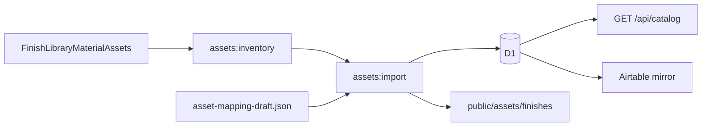

# Finish PNG asset pipeline

**Plain language summary:** Factory PNG renders live in `public/assets/finishes/`. D1 stores which catalog finish maps to which PNG. Airtable mirrors D1 read-only for visual review. All writes go through validated repo scripts—never edit production D1 from Airtable.

---

## Architecture

| Layer | Role |
|-------|------|
| **Source folder** | `~/Downloads/FinishLibraryMaterialAssets` (local; not in git) |
| **D1** | `finish_asset_variants`, `finish_asset_files`, `finish_asset_links` |
| **Pages static** | `public/assets/finishes/{material}/base|graphic/…` |
| **Airtable** | Read-only mirror (`npm run airtable:sync`) |
| **Draft mappings** | [`data/asset-mapping-draft.json`](../data/asset-mapping-draft.json) |



---

## Commands

```bash
# 1. Scan source folder → data/asset-inventory.json
npm run assets:inventory
# Optional: npm run assets:inventory -- --source /path/to/FinishLibraryMaterialAssets

# 2. Propose finish ↔ PNG links (review/edit draft before import)
npm run assets:suggest

# 3. Copy PNGs, emit seed-finish-assets.sql, patch static catalog
npm run assets:import

# 4. Validate paths, FKs, and mapping rules
npm run assets:validate

# 5. Apply schema + seed (local dev)
npm run db:migrate:assets:local
npm run db:seed:assets:local

# 6. Remote D1 (backup first in Cloudflare dashboard)
npm run db:migrate:assets
npm run db:seed:assets

# 7. Mirror D1 → Airtable (optional; needs AIRTABLE_API_KEY + AIRTABLE_BASE_ID)
npm run airtable:sync
```

---

## Safe CRUD rules

1. **D1 is source of truth** — not Airtable, not the Downloads folder alone.
2. **Backup D1** before bulk `db:seed:assets` on remote.
3. **Idempotent imports** — `INSERT OR REPLACE` with stable IDs (`fav-*`, `faf-*`).
4. **Never** `DELETE FROM finishes` in asset scripts.
5. **`ON DELETE RESTRICT`** on asset links — cannot delete catalog rows still linked.
6. **Soft deprecate** files with `is_active = 0` instead of deleting PNGs.
7. **Review** `data/asset-mapping-draft.json` in git before `assets:import`.
8. **Re-import factory xlsx** clears asset links for factory finishes only (scoped DELETE in `import-finish-library.mjs`).

---

## Proposing new mappings (non-developers)

1. Open Airtable mirror base (see [`data/airtable-base-schema.json`](../data/airtable-base-schema.json) for table layout).
2. Or edit `data/asset-mapping-draft.json` via a PR with PD/WD review.
3. WD runs `npm run assets:validate && npm run assets:import`.
4. Deploy Pages + seed remote D1 when approved.

**Do not** connect Airtable automations that write to D1.

---

## Static asset layout

```
public/assets/finishes/
  stainless_steel/
    base/{variant-slug}.png
    graphic/{graphic-folder}/{variant-slug}.png
  ceramic/base/.gitkeep
  glass/base/.gitkeep
  plastic/base/.gitkeep
```

Filename rules: [`data/asset-filename-map.json`](../data/asset-filename-map.json).

---

## Airtable base setup

1. Create base **Core Home Finish Library (Mirror)**.
2. Create tables from [`data/airtable-base-schema.json`](../data/airtable-base-schema.json).
3. Set repository secrets / local env:
   - `AIRTABLE_API_KEY`
   - `AIRTABLE_BASE_ID`
4. Run `npm run airtable:sync` after catalog or asset imports.

Without credentials, `npm run airtable:sync` writes `data/airtable-mirror-export.json` offline.

---

## Related

- [12 — Database and multi-material](12-database-multi-material.md)
- [finish-catalog-import.md](finish-catalog-import.md)
- [`schema.sql`](../schema.sql) · [`migrations/003_finish_assets.sql`](../migrations/003_finish_assets.sql)
